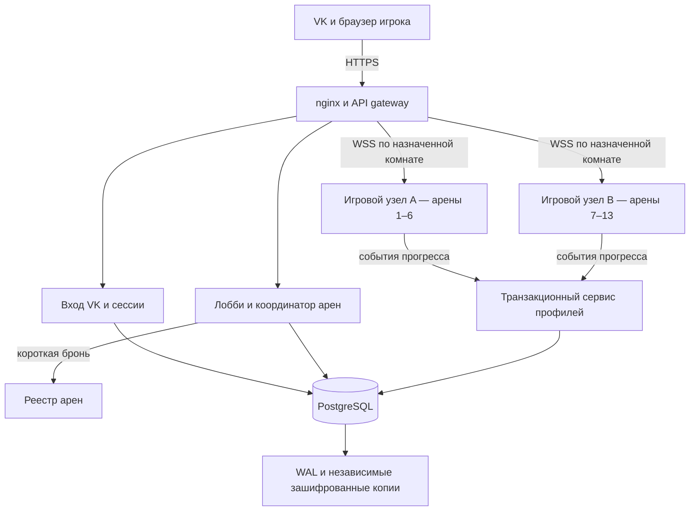

# Внедрение нескольких арен и VK в существующий код

Уточнение 10.11.2026: ниже исторический проект с PostgreSQL, а не описание работающей системы. Текущий выбор - бесплатный MongoDB Atlas с локальным WAL. [Актуальные решения и границы тестового стенда](../../docs/architecture-advice-20261110.md) имеют приоритет. Не включать `pm2 -i max`, старый PostgreSQL entrypoint или реальную оплату по этому плану. `auth/vk-mini-app-launch.js` проверяет только Mini Apps; этот формат не объявлен форматом нашей будущей карточки Games.

Схема рассчитана на переиспользование нашей серверной `Arena`, правил опыта, кланов, бустеров и интерфейса. Переписывать симуляцию на другой движок ради 400 пользователей не требуется. Сначала отделяем транспорт и сохранения, затем подключаем подготовленное распределение.

## Компоненты и направление запросов



В первом выпуске достаточно одного логического координатора. Его `ArenaDirectory` сериализует операции, поэтому две брони не занимают одно место. **Нельзя создать независимый экземпляр этой Map в каждом API-процессе.** Все реплики API обращаются к одному координатору. Для его отказоустойчивой замены нужны реестр и lease с поколением в PostgreSQL либо атомарные операции в Redis/Valkey; имеющаяся модель этого ещё не делает.

Redis/Valkey необязателен для первого стенда. Если появится, хранить там присутствие, краткие брони и кэш рейтингов, но не единственные копии балансов и покупок. При потере кэша запретить новые входы до сверки с живыми workers; нельзя просто считать все места свободными.

## Где менять существующий проект

| Существующий файл и место | Необходимая работа |
| --- | --- |
| `server.js`, `src/server/game-server.js` → `startServer` | Оставить локальную точку запуска; сделать отдельную production-точку с проверкой обязательной конфигурации |
| `src/server/game-server.js` → `createGameServer` | Разделить HTTP профиля, координатор и lifecycle комнат; убрать единственную глобальную `arena` из API |
| Там же → `upgrade`, `wss.on("connection")` | Проверять сессию, билет, назначенный `arenaId`, worker epoch и лимит 35 до создания игрока |
| Там же → `profileConnections`, `requireLobby` | Проверять активную арену профиля через общий реестр, а не Map одного процесса |
| Там же → `tick`, `commitProgress`, `broadcast` | Отделить 20 Гц симуляции от сохранений/рассылки; события с идентификаторами арены и поколения |
| `src/server/arena/arena-simulation.js` | Переиспользовать `Arena`; одна игровая жизнь находится только в одной комнате |
| `src/server/profiles/profile-store.js` | Выделить чистые игровые операции и асинхронный PostgreSQL repository; не ставить Promise на место нынешнего синхронного `save` |
| `src/server/clans/clan-service.js` | Транзакции нескольких профилей и клана, единый порядок блокировок; лимит состава проверять на сервере |
| `src/server/game-server.js` → `competitionTimer` | Один планировщик недель/суток/наград с уникальными ключами задания; не один на каждую арену |
| `public/game-client.js` → `joinArena` | Сначала POST бронирования, потом WSS назначенной комнаты; сейчас используется только `location.host` |
| `public/index.html` → `joinForm` | Добавить кнопку списка арен рядом с «Играть», клавиатурное управление и подписи занятости |
| `public/ui/boosters/shop-and-inventory-dialog.js` и остальные API-вызовы | Общий HTTP-клиент с авторизацией, обработкой истечения сессии и requestId |
| `public/ui/shop/mock-payment-dialog.js` | Production-адаптер вызывает окно VK; mock остаётся только в локальном режиме |
| `public/shared/virtual-product-catalog.js` | Сохранить стабильные productId; цены/награды загружать и проверять сервером |
| `src/server/http/request-rate-limits.js` | Доверять IP-заголовку только от собственного proxy, применять лимиты по профилю и IP |
| `src/server/http/static-file-server.js` | Статика с версионированием и кэшем/CDN; JSON API с no-store; не публиковать data, config, deployment и секреты |

Новый код логично размещать в `src/server/multiplayer/`, `src/server/auth/`, `src/server/storage/postgres/`, `src/server/payments/` и `public/ui/lobby/arena-picker.js`. Это **планируемые пути**, сейчас этих интеграционных модулей ещё нет. Рабочая модель расположена в `deployment/vk-production/arena-directory.js`.

## Авторизация внутри VK

После проверки формата запуска конкретной игры сервер получает подтверждённый VK user ID и сопоставляет `(vk_app_id, vk_user_id)` постоянному внутреннему UUID. Ник, аватар и переданный клиентом ID не являются доказательством личности.

Для VK Games адаптер должен проверять именно подпись/ключ, предусмотренные документацией выбранного типа приложения, с серверным секретом. Не принимать одновременно несколько непроверенных вариантов «на всякий случай». Пример `vk_* + sign` относится к Mini Apps; официальный репозиторий этого примера архивирован и сам по себе не доказывает пригодность для Games. [Источник VKCOM](https://github.com/VKCOM/vk-apps-launch-params).

Игра сейчас использует `HttpOnly; SameSite=Strict` cookie. Во внешнем iframe это не обеспечивает надёжный вход: браузеры по-разному ограничивают сторонние cookie. Даже `SameSite=None; Secure` не решает все блокировки. [Документация браузеров о third-party cookies](https://developer.mozilla.org/en-US/docs/Web/Privacy/Guides/Third-party_cookies).

Предлагаемый поток: проверенный запуск VK → короткая серверная сессия → bearer-токен в памяти страницы → авторизованные API-запросы. Перезагрузка страницы повторно проходит проверку запуска, а не создаёт новый профиль. Для обновления долгой сессии нужен отдельный проверенный механизм с ограничением срока и возможностью отзыва.

Браузерный WebSocket не позволяет произвольно задать Authorization header. Поэтому API выдаёт одноразовый билет на 15 секунд. WSS подключается к назначенной комнате и передаёт билет первым сообщением в течение 5 секунд. До проверки билета нельзя вызывать `Arena.addPlayer`, отправлять снимки или выполнять команды. Ограничить число таких неподтверждённых сокетов и их payload.

Не записывать подписи VK, токены, билеты и секреты в URL логов, аналитику или сообщения об ошибках. `Referrer-Policy: no-referrer`; origin входящего WebSocket должен совпадать с origin **страницы самой игры**, а не безусловно с `vk.com`. `frame-ancestors` отдельно разрешает оболочке VK встраивать игру.

## Предлагаемый сетевой контракт

Локальные `GET /api/arenas`, бронирование и отмена, а также `/ws/arena-N` уже подключены с 25 октября 2026 года. Они используют cookie профиля и билет в дополнительном WebSocket-подпротоколе, а не первое сообщение `join`. Актуальная реализация: [правила арен](../../docs/rules/arenas.md). Остальная таблица описывает будущую распределённую интеграцию:

| Запрос | Ответ или действие |
| --- | --- |
| `POST /api/auth/vk` | Проверка данных запуска; `{accessToken, expiresAt, profile}` |
| `GET /api/arenas` | `{arenas:[{id,name,status,playing,reserved,capacity,joinable}]}` |
| `POST /api/arena-reservations` с `preferredArenaId`, `requestId` | `{arenaId,ticket,expiresAt,wsPath,redirected}` либо код отказа |
| `POST /api/arena-reservations/cancel` | Отменить только бронь текущего профиля |
| `WSS /ws/arena-N`, первое сообщение `join` | Проверка билета, подтверждение назначения, затем `welcome` и начальный снимок |
| `POST /api/payments/vk/callback` | Проверенный обработчик уведомлений VK; формат ответа задаёт VK |
| `GET /health/live`, `/health/ready` | Жив ли процесс; доступны ли БД, координатор и минимум три арены |

`workerLease` из модели — внутренний идентификатор поколения worker. Gateway не должен отдавать его в публичный ответ: worker получает его по доверенному внутреннему каналу. Подтверждение брони и создание игрока должны образовать управляемую последовательность: закрепить место, создать игрока, при ошибке освободить место, при неизвестном исходе сверить sessionId. Повтор HTTP-запроса с тем же requestId возвращает тот же результат.

Лобби обновляет присутствие раз в 20 секунд и список арен раз в 3–5 секунд либо через события. Не держать игровой поток 20 Гц для пользователя лобби. Просрочка присутствия — 90 секунд. Worker сообщает о здоровье каждые 2 секунды; после 10 секунд без heartbeat его комнаты закрываются для новых входов.

При разрыве связи предложен 15-секундный период переподключения: место остаётся занятым, шар продолжает существовать и подчиняться правилам боя. Игрок не получает второй шар. После срока worker завершает жизнь и фиксирует результат. Этот reconnect-поток в заготовке **ещё не реализован**.

Обновления комнаты идут только участникам этой комнаты. Балансировщик не выбирает случайный worker после бронирования: `/ws/arena-N` разрешается через реестр. Заголовки Upgrade/Connection и таймауты должны быть настроены для WSS. [Официальное руководство nginx](https://nginx.org/en/docs/http/websocket.html).

## Сокращение трафика

1. Имена, скины, кланы, статичные параметры, каталог и неизменившийся эфир отправлять при входе или изменении, а не каждый тик.
2. Присваивать объектам короткие числовые сетевые ID. Координаты и радиусы передавать с согласованной точностью; отделить визуальную интерполяцию от серверных столкновений.
3. Начать с 10 снимков изменений в секунду при прежней симуляции 20 Гц. Срочные боевые события отправлять независимо. Сравнить ощущение управления и задержки с текущим клиентом.
4. Передавать объекты в области видимости с запасом; лидерборд и события вне области — отдельными компактными сообщениями.
5. Добавить sequence, baseline, подтверждение начального снимка, вход/выход объекта из видимости и запрос полного resync. После потери baseline не применять дельту к неверному состоянию.
6. Проверить компактный JSON, затем бинарный формат по необходимости. Простое включение WebSocket-сжатия не заменяет эту работу и увеличивает затраты CPU.

`safeSend` уже обрывает медленного клиента при очереди >1 МиБ. В новом протоколе измерять `bufferedAmount`, объединять устаревшие визуальные обновления без потери событий и сбрасывать baseline при пропуске зависимой дельты.

## Данные и подтверждение операций

Начальный SQL хранит профиль отдельной строкой JSONB, что позволяет перенести текущие wallet, inventory, progress, activity, account и косметику без выдумывания новых игровых правил. JSONB не отменяет валидацию. Для рейтингов позже добавить индексируемые колонки/проекции с однозначным источником значений.

Действие игрока выполняется так:

1. Проверить сессию, права и формат; получить существующий результат по `(player_id, request_id)`. Повтор ключа с другим телом запроса — ошибка.
2. Начать транзакцию; заблокировать нужные профили и кланы в стабильном порядке; перечитать данные.
3. Вычислить выдачу/списание на сервере; обновить профиль, журнал, достижение и outbox.
4. Зафиксировать COMMIT; только затем возвращать успех. При обрыве ответа повтор возвращает сохранённый результат.

Повторная покупка с **новым** подтверждённым order ID учитывается в достижениях. Повтор доставки **того же** заказа не начисляет продукт повторно. Ежедневный бесплатный бонус не становится покупкой. Для бонусов действует уникальность `(игрок, VIP/Premium, валюта, день Москвы)`; 00:00 Москвы вычисляется на сервере.

Транзакции защищают связанные изменения, а уникальные ограничения — от повторной доставки. Ошибки сериализации/взаимоблокировок требуют ограниченного повтора всей транзакции с тем же идентификатором. [Изоляция транзакций PostgreSQL](https://www.postgresql.org/docs/18/transaction-iso.html).

Прогресс арены: ключ `(arenaId, workerEpoch, sequence)` вместо одного глобального `progressReceipt`. Надёжные экономические события записывать до подтверждения. Массу, координаты и время жизни не переписывать в общий профиль 20 раз в секунду. Метрики времени/максимума можно объединять за 1 секунду, явно принимая возможную потерю последней неподтверждённой секунды при аварии. Покупки, награды уровней, сундуки и траты бустеров должны иметь долговечные события и идемпотентное применение.

При недоступной БД не выдавать новые награды «в долг» только в RAM. Ограниченная очередь допускается для неподтверждённых событий; при достижении лимита комнату безопасно приостановить, сохранить журнал и показать проблему связи. Систему нельзя бесконечно продолжать с расходящимися балансами.

## Оплата голосами

Клиент вызывает поддерживаемое VK окно покупки. Цена и продукт берутся из серверного каталога. Обработчик уведомлений проверяет подлинность сообщения по документации Games, соответствие приложения, пользователя, товара, суммы и статуса. Выдача, продление аккаунта, начисление достижения и фиксация order ID — одна транзакция.

Ответ «покупка успешна» от интерфейса VK используется для обновления страницы; сам по себе он не разрешает выдачу. Отмена не выдаёт продукт. Повторный callback после таймаута возвращает прежний результат. Возврат платежа обрабатывается отдельной идемпотентной корректировкой по согласованным правилам.

В production должны быть выключены **все** локальные способы бесплатной выдачи: `/api/mock-payments/confirm`, прямое тестовое включение аккаунта, dev-скрипты и тестовые боты. Одной блокировки mock URL в nginx недостаточно. Проверить маршруты нынешнего `game-server.js`, а не только скрыть кнопки. Локальное окружение сохраняет mock-платежи.

## Порядок миграции и проверки

Этап 1: выделить repository и транзакционные операции; прогнать существующие проверки механик сначала с файловым хранилищем, затем с новой тестовой PostgreSQL. Проверить реальные SQL constraint, конкурентные покупки, состав клана и повтор наград.

Этап 2: новый production entrypoint, VK auth и платежный adapter. Пока нет всех обязательных параметров и успешной проверки схемы — процесс не объявляет readiness. Нынешний `server.js` продолжает локальную работу.

Этап 3: реестр арен, резервирование, workers, список в лобби, маршрутизация, общий запрет двойного входа и reconnect. Новые комнаты становятся joinable только после подтверждения готовности worker.

Этап 4: сетевые изменения и нагрузочный тест. Симуляция клиента должна посылать реальные команды движения, деления, кормления и бустеров; 400 простаивающих WebSocket не доказывают производительность боя.

Этап 5: перенос данных в закрытом окне обслуживания. Остановить запись JSON, сделать копию и хэш, импортировать профили/кланы/инвентарь/историю выдачи, сверить количество записей и балансы. Автоматически связать локальные профили с VK по нику нельзя: нужна проверенная таблица соответствий владельцев. Не импортировать тестовые начисления в публичную экономику без отдельного решения владельца.

Этап 6: открыть тестовый вход, проверить права и сохранения, затем переключить production. После первых новых транзакций нельзя откатываться на старый JSON: это потеряет покупки. Откат приложения должен использовать ту же совместимую БД, либо применяется проверенная обратная миграция.

## Критерии готовности на 400 человек

- 400 играющих + 30 лобби-сессий минимум 60 минут; пиковая волна входа 100 участников; в каждой арене не более 35 с учётом броней.
- Порог 80 действительно подготавливает две комнаты; то же для 150, 220, 290, 360; полный выбранный сервер перенаправляет.
- Неподготовленные/упавшие комнаты не получают новых игроков; сообщение отказа соответствует утверждённому тексту.
- При 16 частях у 35 участников, кормлении, снарядах, поджоге и поглощении p99 тика меньше 50 мс; желательный p95 меньше 25 мс; CPU не держится выше 70% длительно.
- Измерен исходящий канал, включая статику, пик 13 комнат и медленных клиентов. Расчёт в 1 Гбит/с подтверждён настоящим тестом.
- При убийстве worker страдает только его набор арен. После перезапуска координатора нет двойных шаров и повторной выдачи.
- Покупка подтверждена один раз при 10 повторных callback; двойной клик бонуса, повтор результата жизни и повтор level-up не дают лишнюю валюту.
- Пропажа БД, заполненный диск и сбой backup дают сигнал и понятный отказ без ложного «успешно».
- Восстановление в новую БД реально выполнено и проверено; известны потеря последних данных и время восстановления.
- VK iframe проверен в Chrome, Firefox, Edge, Safari и требуемых мобильных оболочках, включая блокировку сторонних cookie и истечение сессии.

## Проверка подготовленных файлов сейчас

Из корня игры, без запуска дополнительных серверов:

```powershell
node --test deployment/vk-production/tests/*.test.js
node deployment/vk-production/measure-arena.js
node deployment/vk-production/backup-postgres.js
```

Последняя команда при штатном окружении выводит `{"status":"disabled"}`. Она не копирует рабочую игру и не обращается к БД. Первая проверяет модель и заглушки внешних backup-утилит; не является проверкой настоящей инфраструктуры PostgreSQL/S3.
